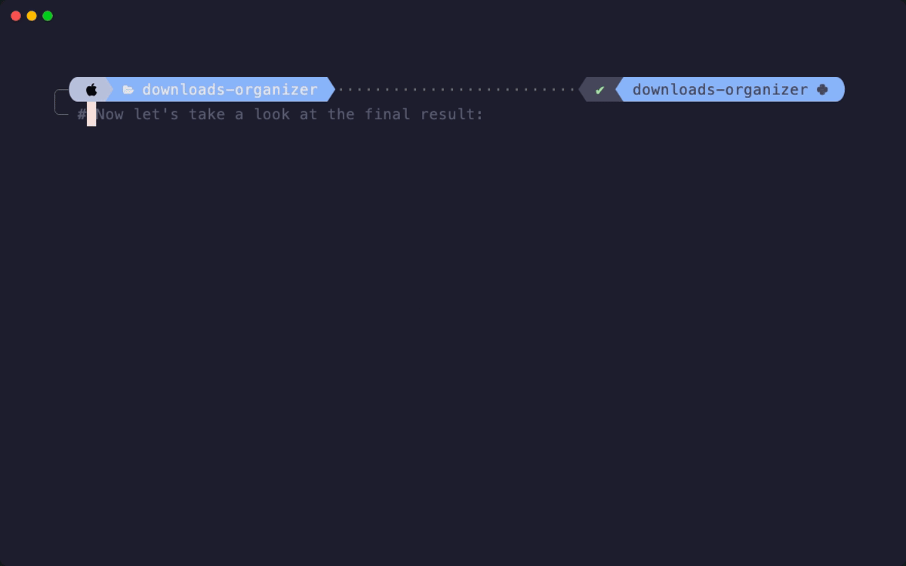

<div align="center">

# 📂 Downloads Organizer

> **A lightweight, privacy-first Downloads folder organizer written in Python.**

[](https://python.org)
[](LICENSE)
[](#-quick-start)
[](#-privacy--philosophy)
[](https://github.com/a-endari/downloads-organizer/stargazers)
[](https://test.pypi.org/project/downloads-organizer/)
[](https://github.com/a-endari/downloads-organizer/actions)

</div>

---

## Table of Contents

- [Demo](#demo)
- [Why Download This?](#why-download-this)
- [What Gets Sorted](#what-gets-sorted)
- [Installation](#-installation)
- [Quick Start](#-quick-start)
- [Configuration](#configuration)
- [Privacy & Philosophy](#privacy--philosophy)
- [License](#license)

---

## Demo

Here is `downloads-organizer` in action:



_This demo terminal recording was created using [VHS](https://github.com/charmbracelet/vhs) by Charm._

---

## Why Download This?

I built this because my own Downloads folder was a mess — hundreds of PDFs, screenshots, installers, and code files all mixed together. I wanted something that:

- **Just works** — one command: `downloads-organizer organize`
- **Stays out of my way** — runs in milliseconds, no background daemon, no UI
- **Respects my privacy** — zero network calls, zero telemetry, zero AI
- **Handles macOS apps correctly** — treats `.app` bundles as single files
- **Lets me customize** — simple TOML config when I want it, sensible defaults when I don't

No subscriptions, no cloud, no nonsense. Just a clean Downloads folder.

---

## What Gets Sorted

By default, files are organized into these 9 categories (all customizable via config):

| Category | Default Folder | Common Extensions |
| -------- | -------------- | ----------------- |
| 📄 Documents | `Documents` | `.pdf`, `.doc`, `.docx`, `.xlsx`, `.pptx`, `.txt`, `.md`, `.csv` |
| 🖼️ Pictures | `Pictures` | `.jpg`, `.png`, `.webp`, `.gif`, `.heic`, `.avif`, `.svg` |
| 🎵 Audio | `Audio` | `.mp3`, `.wav`, `.flac`, `.aac`, `.m4a`, `.ogg` |
| 🎬 Video | `Video` | `.mp4`, `.mkv`, `.mov`, `.webm`, `.avi`, `.m4v` |
| 💻 Code | `Code` | `.py`, `.js`, `.ts`, `.html`, `.css`, `.json`, `.toml`, `.cpp`, `.rs` |
| ⚙️ Programs | `Programs` | `.exe`, `.dmg`, `.pkg`, `.deb`, `.app`, `.msi`, `.apk` |
| 📦 Compressed | `Compressed` | `.zip`, `.tar`, `.gz`, `.7z`, `.rar`, `.bz2`, `.iso` |
| 📚 Ebooks | `Ebooks` | `.epub`, `.mobi`, `.azw`, `.azw3`, `.fb2` |
| 📁 Other | `Other Files` / `Other Folders` | Everything else |

> 💡 **Customizable:** Change folder names, add categories, or override rules in your config file. See [Configuration](#configuration).

---

## 🚀 Installation

### Option 1: **pipx** (Recommended — System-wide, isolated)

```bash
pipx install downloads-organizer --index-url https://test.pypi.org/simple/
```

> **Why pipx?** Installs in an isolated environment, makes `downloads-organizer` available globally, and avoids polluting your system Python. Best for CLI tools.

#### Installing pipx

| Platform | Command |
| -------- | ------- |
| **macOS** | `brew install pipx && pipx ensurepath` |
| **Linux** | `sudo apt install pipx && pipx ensurepath` (or your distro's equivalent) |
| **Windows** | `pip install pipx && pipx ensurepath` (requires Python + PATH) |

After installing pipx, restart your shell, then run the pipx install command above.

---

### Option 2: **pip** (From TestPyPI)

```bash
pip install downloads-organizer --index-url https://test.pypi.org/simple/ --no-deps
```

> This package has zero runtime dependencies. `--no-deps` avoids TestPyPI dependency resolution issues.

---

### Option 3: **From Source** (Development)

```bash
git clone https://github.com/a-endari/downloads-organizer.git
cd downloads-organizer
pip install -e .
```

---

### Option 4: **pip** (From PyPI — *Coming Soon*)

```bash
pip install downloads-organizer
```

---

## 📖 Quick Start

```bash
# 1. See what's in your Downloads
downloads-organizer

# 2. Preview changes (dry run)
downloads-organizer organize --dry-run

# 3. Run the organization
downloads-organizer organize

# 4. Organize specific categories only
downloads-organizer organize --only Documents
downloads-organizer organize --only Code,Programs

# 5. Get help
downloads-organizer --help
```

---

## Configuration

Customize folder names, add ignore rules, or create your own categories via a TOML config file.

**Config file locations:**
- **macOS/Linux:** `~/.config/downloads-organizer/config.toml`
- **Windows:** `%APPDATA%\downloads-organizer\config.toml`

**Quick example:**
```toml
[ignore]
files = [".DS_Store", "desktop.ini", ".gitkeep"]
directories = ["In_Progress", "Keep_Here"]

[categories.documents]
folder = "My Documents"
```

📖 **Full documentation:** [Configuration Guide](docs/configuration.md)

---

## Privacy & Philosophy

- **100% offline** — No network calls, ever. Your filenames never leave your machine.
- **No AI** — Deterministic rules. `tax_return_2024.pdf` always goes to Documents. No hallucinations, no surprises.
- **No telemetry** — No usage tracking, no analytics, no phone-home.
- **Safe by default** — Always preview with `--dry-run` first.
- **Open source** — Read the code, audit the logic, fork it.

I built this for myself because every other tool either phoned home, required a subscription, or tried to be "smart" with AI. This does one thing well.

---

## License

MIT License — use it, fork it, modify it freely.

See [LICENSE](LICENSE) for details.

---

<div align="center">

### Made with 💙 by [a-endari](https://github.com/a-endari)

[⭐ Star on GitHub](https://github.com/a-endari/downloads-organizer) • [🐛 Report Issue](https://github.com/a-endari/downloads-organizer/issues) • [💬 Start Discussion](https://github.com/a-endari/downloads-organizer/discussions)

</div>
